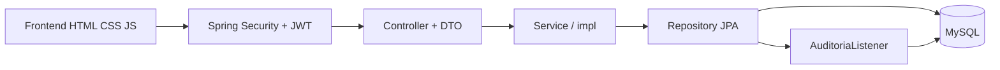
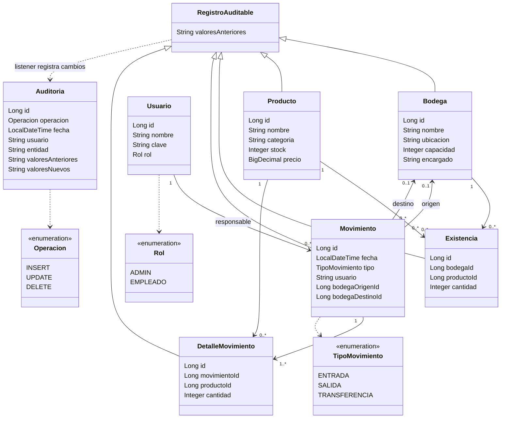

# Cómo funciona LogiTrack

## Arquitectura sencilla
Para registrar una entrada de 10 cuadernos:
1. El frontend envía JSON y JWT a `POST /movimientos`.
2. Spring Security verifica firma, emisor y caducidad del token.
3. El controlador recibe un DTO; `@Valid` revisa campos obligatorios.
4. El servicio valida bodegas, capacidad y productos; actualiza inventario.
5. Los repositorios guardan las entidades con JPA en MySQL.
6. El listener registra automáticamente los cambios.
7. La API devuelve JSON y la interfaz muestra el resultado.



| Carpeta | Para qué sirve |
|---|---|
| controller | Define rutas y respuestas HTTP |
| service | Interfaces de las operaciones |
| service/impl | Reglas del negocio y transacciones |
| repository | JpaRepository y consultas |
| model | Entidades que representan tablas y enums |
| dto/request | Campos permitidos al recibir JSON |
| dto/response | Datos devueltos al cliente |
| mapper | Copia campos entre entidades y DTOs |
| config | Seguridad, Swagger y listener |
| security | Creación de JWT |
| exception | Errores y manejo global |
| frontend | HTML, CSS y JS sin framework |

Como en springV se usa `@RequiredArgsConstructor` con campos `private final`, servicios con interfaces, Lombok, DTOs `record` y mappers manuales. No se usa MapStruct ni framework de frontend.

## Diagrama de clases
GitHub renderiza Mermaid. Las asociaciones son claves foráneas; para simplificar, las entidades guardan los IDs y el servicio consulta sus registros. No hay relaciones bidireccionales ni colecciones JPA recursivas.



`RegistroAuditable.valoresAnteriores` es temporal (`@Transient`): no crea columna ni aparece en JSON. `Auditoria.valoresAnteriores` sí se guarda. Auditoria conserva el nombre del usuario y una fotografía JSON incluso después de eliminar el registro.

## Inventario y transacciones
`Producto.stock` suma las unidades del producto en todas las bodegas. `Existencia` guarda cuánto hay en una bodega específica. La pareja bodega + producto es única. Ejemplo: 10 cuadernos en Norte y 4 en Sur → stock total 14.

| Tipo | Origen | Destino | Stock total |
|---|---|---|---|
| ENTRADA | No | Obligatorio | Aumenta |
| SALIDA | Obligatorio | No | Disminuye |
| TRANSFERENCIA | Obligatorio | Obligatorio, diferente | Se conserva |

Capacidad significa unidades de todos los productos almacenados, no volumen. Los nuevos productos empiezan en cero; el stock inicial se registra con ENTRADA. No se edita `stock` directamente porque se perdería la ubicación y la trazabilidad.

`@Transactional` guarda todo o deshace todo. Si falla el segundo producto de una salida, no queda el primero ni auditorías parciales.

`PESSIMISTIC_WRITE` bloquea las bodegas en orden de ID hasta terminar. Así, dos usuarios no gastan las mismas unidades simultáneamente. Esta solución sencilla serializa los movimientos; en un sistema de mayor volumen podría usarse un bloqueo más específico. Los cambios de catálogo usan el mismo orden de bloqueo.

Los movimientos no se editan ni borran. Los productos y bodegas con historial no se pueden eliminar; DELETE funciona para registros sin relaciones históricas.

## Auditoría automática con EntityListeners
`RegistroAuditable` lleva `@EntityListeners(AuditoriaListener.class)`. Hibernate obtiene el listener desde Spring.

- `@PostLoad`: toma una copia JSON al leer la entidad.
- `@PostPersist`: INSERT con nuevos valores, sin anteriores.
- `@PostUpdate`: UPDATE con ambos valores.
- `@PreRemove`: DELETE con últimos valores, sin nuevos.

El usuario se obtiene de `SecurityContextHolder`, no del JSON enviado. `JdbcTemplate` inserta la auditoría en la **misma transacción** que JPA; se usa JDBC para no provocar otro flush dentro de un callback JPA. Si hay rollback, también se deshace la auditoría.

Se auditan Bodega, Producto, Existencia, Movimiento y DetalleMovimiento. Auditoria no se audita a sí misma. Usuario no se serializa en la auditoría, evitando guardar hashes de contraseña. Registro y login son autenticación, no cambios del inventario.

Los scripts SQL iniciales y cambios manuales en Workbench no disparan listeners JPA. Por tanto, el cambio manual de rol no genera una auditoría de aplicación. Se registran los cambios hechos mediante los servicios JPA.

Fechas de movimientos y auditorías: UTC. El filtro usa `2026-11-17T14:00:00`, sin sufijo. En Colombia, UTC está cinco horas adelante de la hora local.

## JWT y permisos
JWT tiene tres partes: `cabecera.datos.firma`. El contenido está codificado, **no cifrado**. No se ponen contraseñas en el token.

```json
{"alg":"HS256","typ":"JWT"}
```

Payload conceptual:
```json
{"iss":"logitrack","sub":"laura","rol":"ADMIN","iat":1794916800,"exp":1794920400}
```

`sub` identifica al usuario; `rol` indica permisos; `iat` y `exp` son instantes Unix; `iss` es el emisor. Spring valida emisor, firma HS256 y vencimiento. Dura 60 minutos.

Hay un [token educativo completo](JWT-EJEMPLO.md), caducado y firmado con una clave ficticia. Para probar, obtén un token real mediante `/auth/login` y envía:

```http
GET /bodegas HTTP/1.1
Host: localhost:8080
Authorization: Bearer TU_TOKEN_REAL
```

El backend no mantiene una sesión; el frontend guarda el token en memoria y lo borra al salir. No hay renovación ni revocación: al caducar, se hace login otra vez. Salir no invalida copias del token antes de caducar. Los cambios de rol en SQL se reflejan en tokens nuevos.

El registro público siempre crea EMPLEADO. ADMIN puede administrar catálogos y consultar auditorías; ambos roles pueden consultar datos y registrar movimientos.

## Validaciones y errores
- `@NotNull`: dato obligatorio.
- `@NotBlank`: texto no vacío ni de solo espacios.
- `@Size`: longitud o tamaño permitido.
- `@Min` / `@Max`: cantidades válidas.
- `@DecimalMin` / `@Digits`: precio positivo con dos decimales como máximo.
- `@Valid`: aplica validación al DTO y a los productos del movimiento.

`GlobalExceptionHandler` usa `@RestControllerAdvice`, que incluye `@ControllerAdvice`. Los filtros de seguridad devuelven el mismo formato mediante SecurityConfig.

```json
{"fecha":"2026-11-17T14:30:00","estado":400,"mensaje":"Stock insuficiente en la bodega origen.","ruta":"/movimientos"}
```

400: datos inválidos o regla de negocio; 401: no autenticado; 403: sin permiso; 404: no encontrado; 500: fallo inesperado. Los detalles internos del 500 se guardan en el log, no se exponen al cliente.

## Consultas avanzadas
- Stock bajo: stock total menor a 10, incluido cero.
- Fechas: `findByFechaBetweenOrderByFechaDesc`; límites inclusivos. Deben enviarse ambos o ninguno.
- Auditorías: usuario y operación son opcionales; con ambos se aplica una condición AND.
- Resumen: incluye bodegas con cero unidades. Los más movidos se ordenan por suma de cantidades de entradas, salidas y transferencias. Una transferencia se cuenta una vez. No es stock neto ni número de operaciones.

## Orden recomendado para estudiar
1. Producto → ProductoDtoRequest/Response → ProductoMapper.
2. ProductoRepository → ProductoServiceImpl → ProductoController.
3. MovimientoServiceImpl para las reglas de inventario.
4. SecurityConfig y JwtService para autenticación.
5. AuditoriaListener para trazabilidad.

Prueba una bodega, un producto, una entrada y una salida; consulta auditorías después de cada paso.
